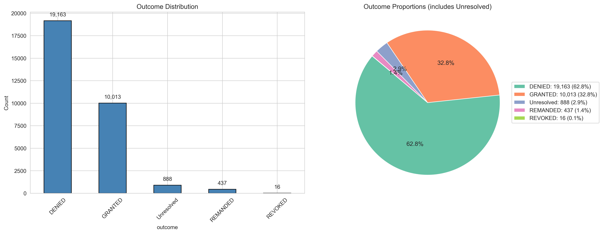
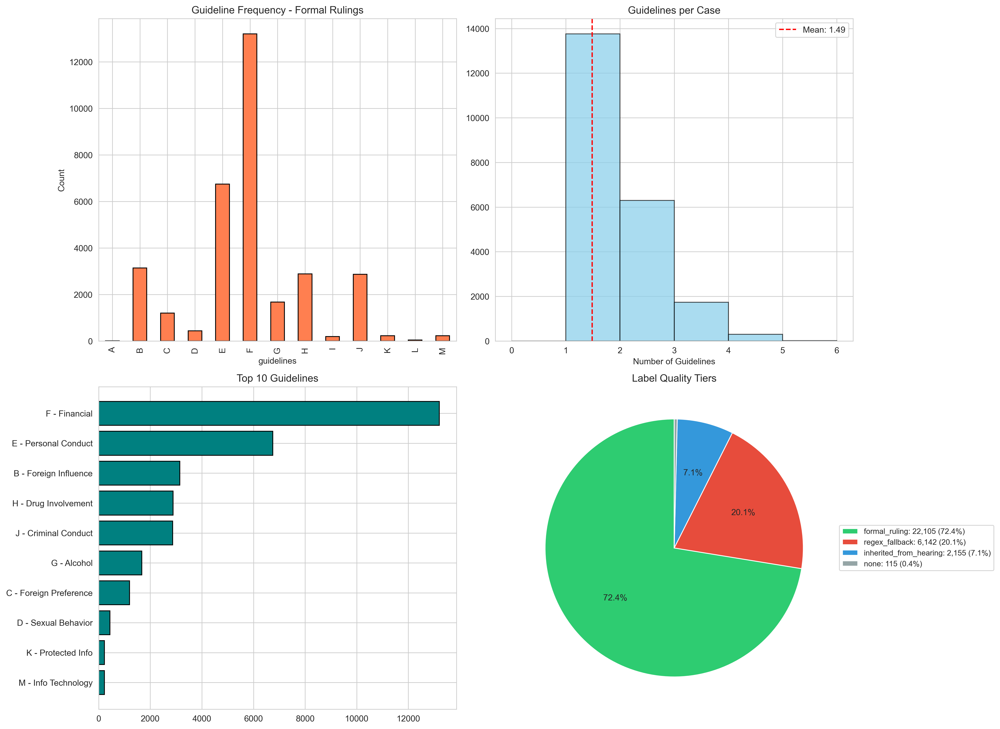
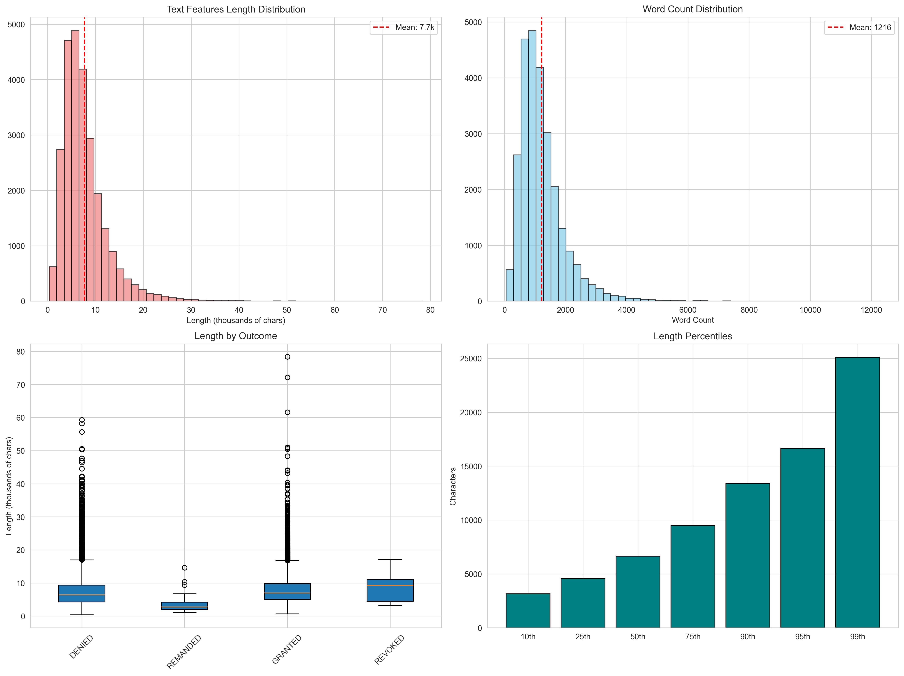

# Exploratory Data Analysis Report
## DOHA Security Clearance Decisions Dataset

**Date:** October 13, 2026  
**Dataset:** Challenge_Data (30,517 cases)  
**Analysis:** Outcome distribution, guideline frequency, text length characteristics

---

## Executive Summary

This EDA analyzes 30,517 DOHA security clearance decisions spanning 1996-2026. The dataset shows significant class imbalance (62.8% denied, 32.8% granted) and data quality issues that impact ML readiness. After fixing counting bugs and separating label quality tiers, 21,959 cases (71.9%) are suitable for training high-quality ML models.

### Critical Fixes Implemented

1. **Empty string handling**: 4,199 cases (13.76%) with empty `text_features` now properly excluded from analysis
2. **Label tier separation**: Formal rulings (authoritative) isolated from regex fallbacks (~60% precision)
3. **Accurate counting**: All statistics now based on valid, non-empty data only

---

## 1. Outcome Distribution

### Overall Statistics

| Outcome | Count | Percentage |
|---------|-------|------------|
| DENIED | 19,163 | 62.79% |
| GRANTED | 10,013 | 32.81% |
| REMANDED | 437 | 1.43% |
| REVOKED | 16 | 0.05% |
| Missing | 888 | 2.91% |

### Key Findings

- **Class imbalance ratio**: 1,197:1 (DENIED:REVOKED)
- **Primary imbalance**: 2:1 (DENIED:GRANTED) requires stratified sampling
- **Case type differences**:
  - Appeals: 77.0% denied, 12.5% granted
  - Hearings: 62.8% denied, 37.1% granted
- **Missing outcomes**: 888 cases (2.91%) lack resolution data



### ML Implications

- Use stratified train/test splits to preserve class ratios
- Consider class weights or SMOTE for minority classes
- Remanded/Revoked cases may need separate handling due to scarcity

---

## 2. Guideline Frequency Analysis

### Label Quality Tiers

| Source | Count | Percentage | Trust Level |
|--------|-------|------------|-------------|
| formal_ruling | 21,959 | 71.97% | Authoritative (with non-empty text) |
| regex_fallback | 6,142 | 20.13% | ~60% precision |
| inherited_from_hearing | 2,155 | 7.06% | Inferred |
| none | 115 | 0.38% | No labels |

### Guideline Frequencies (Formal Rulings Only)

| Guideline | Name | Count | % of Cases |
|-----------|------|-------|------------|
| F | Financial Considerations | 13,204 | 59.73% |
| E | Personal Conduct | 6,746 | 30.52% |
| B | Foreign Influence | 3,143 | 14.22% |
| H | Drug Involvement | 2,882 | 13.04% |
| J | Criminal Conduct | 2,870 | 12.98% |
| G | Alcohol Consumption | 1,671 | 7.56% |
| C | Foreign Preference | 1,199 | 5.42% |
| D | Sexual Behavior | 439 | 1.99% |
| K | Handling Protected Info | 227 | 1.03% |
| M | Info Technology Use | 226 | 1.02% |
| I | Psychological Conditions | 193 | 0.87% |
| L | Outside Activities | 40 | 0.18% |
| A | Allegiance to US | 4 | 0.02% |

### Key Findings

- **Multi-label problem**: Average 1.49 guidelines per case (range: 1-5)
- **Dominant guidelines**: Financial (F) appears in 59.7% and Personal Conduct (E) in 30.5% of formal rulings; 76.9% of cases have at least one of these two
- **Rare guidelines**: Allegiance (A) and Outside Activities (L) each <0.2%
- **Total instances**: 32,844 guideline citations across formal rulings



### ML Implications

- Multi-label classification required (not multi-class)
- Severe label imbalance: F (13,204) vs A (4)
- Rare labels may need focal loss or separate models
- Use formal_ruling tier only for training (72.4% of data)

---

## 3. Text Length Analysis

### Full Text Statistics

| Metric | Characters | Words |
|--------|------------|-------|
| Mean | 19,250 | 2,853 |
| Median | 18,069 | N/A |
| Std Dev | 9,472 | N/A |
| Min | 0 | N/A |
| Max | 115,347 | N/A |
| 10th percentile | 8,173 | N/A |
| 90th percentile | 30,957 | N/A |

### Text Features (Leak-Free, Valid Cases Only)

| Metric | Characters | Words |
|--------|------------|-------|
| Valid cases | 26,318 (86.24%) | 26,318 |
| Empty cases | 4,199 (13.76%) | 4,199 |
| Mean | 7,712 | 1,216 |
| Median | 6,652 | N/A |
| Std Dev | 4,821 | N/A |
| Min | 348 | N/A |
| Max | 78,398 | N/A |

### Key Findings

- **Content reduction**: text_features is 57.4% shorter than full_text (removes verdict leakage)
- **Empty data**: 4,199 cases (13.76%) have empty text_features after cleaning
- **Length by outcome**:
  - REVOKED: 23,339 chars (longest)
  - GRANTED: 20,421 chars
  - DENIED: 19,127 chars
  - REMANDED: 11,955 chars (shortest)
- **Usable training data**: 26,318 cases with valid features



### ML Implications

- Filter out 4,199 cases with empty text_features before training
- Use text_features column exclusively (prevents verdict leakage)
- Consider sequence length limits (e.g., 512/1024 tokens for transformers)
- Document length varies 200x (348 to 78,398 chars)

---

## 4. Data Quality Assessment

### ML Training Readiness

| Criteria | Count | Percentage |
|----------|-------|------------|
| use_for_training flag | 30,510 | 100.0% |
| formal_ruling labels | 22,105 | 72.4% |
| All three criteria met | 21,959 | 71.9% |

### Critical Field Quality

| Field | Issue | Count | Percentage |
|-------|-------|-------|------------|
| outcome | Null | 888 | 2.91% |
| text_features | Empty | 4,199 | 13.76% |
| guidelines | Empty | 115 | 0.38% |
| guideline_regime | Null | 0 | 0.00% |

### Guideline Regime Distribution (Training Set)

| Regime | Count | Percentage |
|--------|-------|------------|
| sead4 | 18,789 | 61.58% |
| unknown | 7,784 | 25.51% |
| directive | 3,937 | 12.90% |

### Data Splitting

- **Unique split groups**: 28,163
- **Cases per group**: 1.1 average
- **Purpose**: Prevents hearing-appeal pairs from spanning train/test boundary

---

## 5. Bugs Fixed in This Analysis

### Bug 1: Empty Strings Counted as Valid Data

**Issue**: `text_features` contained 4,199 empty strings that were counted as valid cases.

**Impact**:
- Previous text statistics inflated case counts
- Mean/median calculations included zero-length cases
- Training would fail on empty inputs

**Fix**:
```python
#Before (buggy)
textFeaturesPresent = dataFrame['text_features'].notna()

#After (fixed)
validTextFeatures = dataFrame['text_features'].str.strip().str.len() > 0
emptyCount = (~validTextFeatures).sum()
```

**Result**: 26,318 valid cases (down from 30,517 reported previously)

### Bug 2: Label Tiers Mixed in Visualizations

**Issue**: Guideline analysis combined formal_ruling (authoritative) with regex_fallback (~60% precision).

**Impact**:
- Inflated guideline counts with unreliable labels
- Training on mixed-quality labels reduces model performance
- No visibility into label source distribution

**Fix**:
```python
#Separate by quality tier
formalRulingData = dataFrame[dataFrame['label_source'] == 'formal_ruling']

#Analyze only authoritative labels
guidelineData = formalRulingData['guidelines'].explode()
```

**Result**:
- Guideline counts now reflect formal rulings only
- Label source quality visualized separately
- Clear guidance to use formal_ruling tier for training

---

## 6. ML Pipeline Recommendations

### Data Filtering

```python
#Recommended filter for training
trainingData = dataFrame[
    (dataFrame['use_for_training'] == True) &
    (dataFrame['label_source'] == 'formal_ruling') &
    (dataFrame['text_features'].str.len() > 0) &
    (dataFrame['outcome'].notna())
]
```

**Expected result**: 21,959 high-quality training cases

### Feature Engineering

1. **Input features**: Use `text_features` column only (leak-free)
2. **Target variables**:
   - Outcome prediction: `outcome` (4 classes, handle imbalance)
   - Guideline classification: `guidelines` (multi-label, 13 classes)
3. **Text preprocessing**: Standard NLP pipeline (tokenization, lowercase)
4. **Note**: 98% of documents exceed 512 tokens, so consider using models that support longer sequences (1024+ tokens) or implement truncation strategies

### Train/Test Split

Use the frozen `split` column already present in `Challenge_Data`:

```python
#Use pre-computed split assignments
train = df[df['split'] == 'train']
test = df[df['split'] == 'test']
val = df[df['split'] == 'val']  #if validation split exists
```

The split column ensures:
- Hearing-appeal pairs stay together
- Balanced distribution across splits
- Reproducible experiments

### Handling Class Imbalance

1. **Stratification**: Already handled by the frozen split assignments
2. **Class weights**: Use `compute_class_weight` for minority classes in training
3. **Evaluation metrics**: Focus on F1-macro, precision/recall per class
4. **Rare classes**: Consider excluding REVOKED (n=16) or grouping with DENIED

### Guideline Regime Consideration

- 25.5% of training data has `guideline_regime='unknown'`
- Consider separate models per regime (sead4, directive, unknown)
- Or use regime as an additional feature

---

## 7. Summary Statistics

### Dataset Composition

- **Total cases**: 30,517
- **Date range**: 1996-03-22 to 2026-01-15 (30 years)
- **Case types**: 25,754 hearings, 4,763 appeals
- **Training-ready**: 21,959 cases (71.9%)
- **Valid text features**: 26,318 cases (86.2%)

### Class Balance

- **Outcome imbalance**: 1,197:1 (worst case)
- **Guideline imbalance**: 3,301:1 (F vs A)
- **Mitigation required**: Yes, for both tasks

### Data Quality Issues Resolved

✓ Empty strings excluded from text analysis  
✓ Label tiers separated in visualizations  
✓ Formal rulings isolated for guideline statistics  
✓ Accurate case counts throughout  

---

## 8. Next Steps

1. **Baseline model**: TF-IDF + Logistic Regression on formal_ruling data
2. **Deep learning**: Fine-tune BERT/RoBERTa on text_features
3. **Multi-label**: Implement binary relevance or classifier chains for guidelines
4. **Evaluation**: Report metrics separately by guideline_regime
5. **Error analysis**: Examine misclassifications on held-out appeals

---

## Technical Notes

- **Script**: `notebooks/03_exploratory_data_analysis.py`
- **Data source**: `Challenge_Data/cases_clean_*.parquet`
- **Visualizations**: All charts regenerated with fixed analysis
- **Runtime**: ~48 seconds on full dataset
- **Dependencies**: pandas, numpy, matplotlib, seaborn

